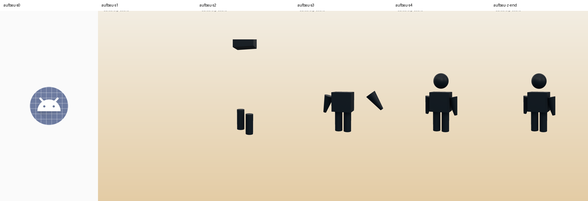
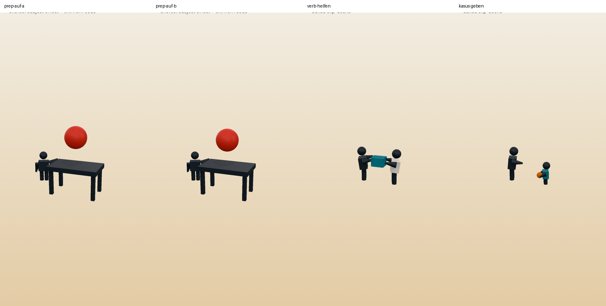

# Android parity audit

What the iOS app (main @ 42b1cc7) has that the Android port (android-port) doesn't, and an
order to close the gap. Written 2026-11-27 from reading both codebases, plus two proofs run in
scratch copies: the 3D scenes exported to GLB and played on the emulator, and the icon
inventory. Screenshots are in `android-parity/shots/`.

Detail per area, with files, storage keys and effort per item:

- [`persistence.md`](android-parity/persistence.md): every SwiftData model and the Android database design (phase 1)
- [`settings.md`](android-parity/settings.md): every Settings pane and control
- [`home-library-onboarding.md`](android-parity/home-library-onboarding.md): tab shell, Home, Library, onboarding, placement quiz, progress
- [`3d-and-learning.md`](android-parity/3d-and-learning.md): every 3D surface, and Cards / Wortschatz / Grammar / Hören / Spiele / Matching
- [`3d-android.md`](android-parity/3d-android.md): 3D rendering options, the GLB export and the SceneView spike
- [`icons.md`](android-parity/icons.md) + [`icon-map.csv`](android-parity/icon-map.csv): every SF Symbol and its Android match
- [`stylus.md`](android-parity/stylus.md): Apple Pencil features and the Android stylus design
- [`voices.md`](android-parity/voices.md) + [`voice-samples/`](android-parity/voice-samples/): German voices on iOS and Android, with samples
- [`ai-platform-infra.md`](android-parity/ai-platform-infra.md): tutor features, content import, sync, notifications, themes, model download, speech

Effort: S ≈ a day or two, M ≈ a few days to two weeks, L ≈ three weeks or more.

## Where things stand

iOS is ~185k lines of Swift across 27 feature folders; Android is ~3k lines of screens on top of
91 shared core files. What Android has: the four tabs, Goethe flashcards (Anki-style SM-2), the
Wortschatz list, Kasus lessons (text), der/die/das, a Präpositionen drill, Lückensätze, Perfekt
haben/sein, Die vier Fälle, Zahlen-Diktat, Galgenmännchen, Wortsuche, and the tutor (typed
Gespräch, Satz prüfen, models copied in with adb).

Android is ahead in a few small places worth keeping: Wortsuche (iOS has the engine, no
screen), the haben/sein quiz, the System/Light/Dark picker, the slow voice sample, per-level
reset, the Version row.

## Database (phase 1)

Most of what's missing saves something: decks, chats, phrases, stories, study days, grammar
rounds, stats. Android today keeps a JSON blob in UserDefaults with its own card ids (`A1:word`),
so every screen built on it would need its storage redone later. The database comes first.

- iOS has **35 `@Model` types**; 30 sync through codecs, 5 stay on the device. Only 5
  relationships (all parent → children cascades), no unique attributes. About 14 struct types
  stored in `Data` fields sit inside SwiftData files and need moving out so Android can decode them.
- **Technology: SkipSQLPlus** (skip-sql 0.16.1, bundles SQLite 3.51.3 and SQLCipher). Plain
  SkipSQL `fatalError`s on Android because the NDK ships no SQLite to link; GRDB has the same gap.
- **Schema: one `record` table** whose payload is exactly what the iOS sync codec writes, plus a
  few index columns (parent, due, day, sort, natural key). Android rows are iOS-readable by
  construction, the sync plan's step 1 comes with it, and new iOS fields need no table changes.
- **Swift API:** a store protocol per aggregate in the core (`DeckStoring`, `StudyLogStoring`,
  `LearnerProfileStoring`, `ConversationStoring`, `PhraseStoring`). iOS adopts them through thin
  SwiftData adapters and keeps `@Query`; nothing changes for iOS users.
- **Migration:** Android's `A1:word` progress moves to iOS's Wortschatz card ids once.
- **Order** (steps 0–5 ≈ two weeks): a SkipSQLPlus spike on the emulator → sync specs into the
  core (on main) → 8 spine record types → the database → decks and Wortschatz (with migration) →
  study-day log (streak, daily new-word budget) → learner profile → saved chats and phrases →
  `.kartei` import → sync-shaped writes and Auto Backup → an iOS test that reads Android's records.

## The things you noticed

### 1. No 3D / Figur animations: it works on Android
Proven in a scratch spike, not yet in the app:
- **Export:** one `export_glb()` call next to `export_usdz` in `figur.py` and `prep_render.py`
  exports all 82 shipped scenes to GLB in 35 s (`tools/glb/glb-export.patch`). Node names like
  `subject` survive, materials come out as standard PBR, 13.6 MB raw vs 26.2 MB of USDZ.
  Multi-clip verb scenes need `export_animation_mode="SCENE"` to come out as one clip.
- **Rendering:** SceneView 4.76.0 (Filament, Compose-native, Apache-2.0; Android's counterpart of
  react-native-filament) in a standalone app on the emulator: die Figur assembles and holds, the
  `helfen` and `geben` clips play, and in `prep3d-auf` the ball is found by name, tinted and moved
  per frame from code, all over a transparent background.

  
  
- **In the app:** a small Kotlin-bridged Skip module, `Kartei3D`, next to `GermanVoice`, shown
  through `ComposeView`. The scene description stays in the shared core; each platform renders it.
- **Costs and catches:** about +6.6 MB APK (arm64, compressed libs); SceneView snaps a finished clip
  back to frame 0, so the module drives playback itself (fix verified); SceneView pulls a newer
  Compose (BOM 2026.09) than Skip uses (2026.05), untested against SkipUI. Not measured yet: frame
  rate on a low-end phone.
- **Rollout:** stills first wherever 3D isn't ready (iOS's own "Stills Only" path, 173 stills
  exist), then baked scenes (Figur, 39 verb, 5 Kasus, celebration), then the preposition scenes
  after their per-frame motion moves into a shared Swift file, then the procedural ones (pyramid,
  journey, Treppe) once they have Blender GLBs.
- **Found on the way** (existing pipeline, not this change): with Blender 5.3, 12 of 39 verb scenes
  fail the USD verify step, and `verb3d-handeln` / `verb3d-verlangen` export with no animation.
- SkipUI has no `Canvas` and stubbed `TimelineView`, so the 2D stand-ins that use `Canvas`
  (Hangman gallows, `PyramidGlyph`, grammar task art) need redrawing with shapes.

### 2. No entry quiz / no quiz in Settings
iOS: a one-time onboarding wizard (welcome → tutor offer → the three-minute check), plus
"Take the three-minute check" in Settings ▸ Your Level and Gamification. Android opens on Home
at A1, and Your Level is an inline A1–B1 picker.

- The engine is nearly portable as is: `PlacementService`, `PlacementSession`,
  `PlacementAttemptStore` import only Foundation; `PlacementResult`/`PlacementAttempt` are
  already in the core. `PlacementGrammarBank` needs `Bundle.main` → `AppResources.bundle`, and
  `placement_grammar.json` isn't copied to Android yet. The UI is SwiftUI without SwiftData.
- No model needed: every item comes from bundled data.
- The level itself changes on Android: iOS stores CEFR A1–C1 under `german.level` (on
  `MLXModelManager`, which Android doesn't share); Android stores Goethe A1–B1 under `level`.
  Split the level setting into a Foundation-only file both apps use.

### 3. Settings is way off
Android has 6 of iOS's 17 panes, all of them partial; it has no icons, no grey summaries,
no `SettingsHeader`, no themes, and different grouping (App/Learning/About vs
Account/App/Learning/Model/About/Developer).

| iOS pane | Android |
| --- | --- |
| iCloud Sync | Missing (Auto Backup → Drive per `sync.mdx`) |
| Appearance (4 themes + 3D scenes) | Partial: System/Light/Dark only |
| Reminders | Missing |
| Voice (voice picker, dialogue voices) | Partial: sample + link to Android TTS settings |
| Keyboard | Missing (Android IME is its own project; `PROCESS_TEXT` is a cheap stand-in) |
| Gamification | Missing (the features behind it are missing too) |
| Your Level + placement check | Partial: A1–B1 picker, no check |
| Flashcards (style, front side, der/die/das first, repeat missed, haptics, matching…) | Partial: new words per session, reset |
| Conversation (name, strictness, corrections, hints, translations…) | Missing, though Gespräch runs on the shared `ConversationConfig` with hard-coded defaults |
| Stories | Missing (Stories not ported) |
| Model & Downloads | Partial as "Tutor Model": no download, RAM check, delete |
| Speicher · Memory | Missing |
| What's New, Send Feedback, Rate | Missing (all S) |
| Sources & Credits | Partial: 3 of 8 sections (the Kasus teaching sources are owed, Kasus lessons ship) |
| Developer | Missing (debug only) |

Fix: rebuild Settings on the `SettingsPane` structure (one list of panes with group, title, icon,
summary), add a Skip-safe `SettingsHeader` (no `symbolEffect`), and use the iOS storage keys.
Key mismatches today: `german.level` vs `level`, `wortschatz.newPerDay`/`sessionCap` vs
`flashcards.newPerSession`, `selectedMLXModel` vs `tutor.model`, `app.theme` vs `appearance`.

### 4. Library looks like an old version
Android lists the three Goethe decks, which iOS's `UnifiedLibraryView` deliberately hides as
activity plumbing. iOS's Library is an archive of what the learner made: Decks · Chats · Reading ·
Phrases, with mix decks, deck stats, share, course assignment and delete. Android can't show that
until the database exists, plus a way to make decks (tutor download, or `.kartei` import from an
iPhone) and saved chats. The shell with iOS's segments and empty states can come right after the
database; the Goethe levels move to Home ▸ Vocabulary where iOS has them.

## Icons

iOS uses **463 distinct SF Symbols** (2,236 uses). They **can't ship on Android**: Apple's
licence limits SF Symbols to Apple platforms, exported or traced SVGs included. So iOS keeps SF
Symbols unchanged and Android gets the closest legal match.

- Today Skip maps 47 of the names (23% of uses); every other icon shows a warning triangle.
- Matches: Material Symbols Rounded alone gives 269 exact, 134 close, 52 meaning-only, 8 none.
  Adding ~30 icons from Phosphor, Lucide and Tabler makes it 303 / 129 / 29 / 2. All are
  Apache-2.0 / MIT / ISC; the app needs a licence notice.
- **No iOS code changes:** SkipUI looks for a `<sf-name>.symbolset` in the Android module's asset
  catalog before its own table, and Google publishes Material Symbols in exactly that format. So
  `Image(systemName: "cpu")` stays as written and shows Material `memory` on Android. A script
  generates the ~440 symbolsets from `icon-map.csv` (`tools/icons/`).
- **Custom drawings needed (8–10, Bauhaus style):** `figure.stairs` (no match anywhere), the card
  stack, the Library-tab head, pyramid, hare, three geometry marks, two 3×3 game grids.
- The tab bar is off today: iOS uses `house` / `checklist` / `brain.head.profile` / `gearshape.2`;
  Android has house / check circle / bookmark / one gear. Seven Home rows differ too.
- Limits: `.symbolEffect` and friends don't compile under Skip (28 call sites, need a no-op
  wrapper); Skip draws icons in one colour, so multicolour/hierarchical modes don't carry over.
- To test first: one Material, one Phosphor and one `.fill` symbolset in the tab bar.

## Stylus / Apple Pencil

iOS runs seven features on one shared Pencil engine: Schreibblatt, the journal page, worksheets,
Quick Draw, Atelier, paint-by-number and "Write it after a miss". Its own tool dock, PencilKit
inks, partial and circle erasers, finger-tap undo, a wrist guard, Pencil Pro squeeze. Handwriting
is read (Vision) in the journal and worksheets.

- **Android has the parts:** Jetpack Ink 1.0 (stable) for strokes and rendering, low-latency
  front-buffered drawing (API 29+), motion prediction, and `MotionEvent` gives stylus vs eraser vs
  finger, pressure, tilt, hover and barrel buttons. ML Kit Digital Ink reads German handwriting
  offline after a ~20 MB model download.
- **Module:** `KarteiInk`, a Kotlin-bridged Skip module wrapping a Jetpack Ink canvas, PDF export
  through `PdfDocument`. Jetpack Ink has no eraser, so whole-stroke erase first, partial later.
- **Devices:** real pens are mostly Samsung Galaxy Tab S / S Ultra, plus USI pens on Pixel Tablet
  and Chromebooks: a small share of users. Treat the stylus as an enhancement: gate on tablet vs
  phone, switch on pen-only drawing once a pen has actually touched the screen, keep finger drawing
  everywhere else.
- **Ink format:** Android can't read PKDrawing. A neutral stroke file in the shared core for later
  iPhone↔Android sync; until then ink stays on the device.
- **Order:** spike (M) → Write it (S) → Quick Draw (S–M) → Schreibblatt (M) → journal with
  recognition (M) → worksheets (L) → Atelier (L).

## Voices

iOS picks voices in the app (pronunciation, plus Man / Woman / Boy / Girl for dialogue), but the
good Enhanced/Premium voices have to be downloaded in iOS Settings ▸ Accessibility, hence the
7-screenshot guide: Apple has no download API. Word highlighting, slow mode, dialogue stories,
lock-screen playback and Stammtisch all ride on the voice. Android's `GermanVoice` only speaks,
stops and opens the system settings.

- **Android can do better than iOS here with the system engine** (tested on the emulator): Google
  TTS has 4 German voices (2 female, 2 male), each offline and network. The app can list them,
  pick one for itself without touching the system default, and `setVoice()` on a not-installed
  voice starts Google's download from inside the app. Word ranges for highlighting arrive while
  speaking. Effort S–M.
- **Better-sounding voices on both platforms, no self-hosting:** Supertonic 3 through sherpa-onnx
  (one C library, linked from Swift the way llama.cpp already is). 10 German voices (5 female, 5
  male) in one 129 MB download from Hugging Face, no GPL phonemizer, about 7× faster than real time
  on the Mac (phone speed not measured). Licence OpenRAIL-M: commercial use allowed, with use
  restrictions passed on to users; needs a quick legal read. No child voices, so Boy/Girl stay on
  system voices.
- **Piper** is a second choice: only `thorsten-medium` and `kerstin-medium` are licensed cleanly for
  commercial use, and sherpa-onnx 2.0 dropped espeak-ng (GPL), so Piper needs another phonemizer.
- **Cloud TTS** (Google, Azure, ElevenLabs, OpenAI): not recommended. A key in the app needs a
  proxy server, it bills per character, and it doesn't work offline.
- **Design:** one Voices screen on both platforms, listing system voices and downloadable Kartei
  voices with size, a sample button, download/delete, and per-role picks. Underneath, a shared
  `SpeechPlayer` in the core with three backends: AVSpeech, Android TTS, sherpa-onnx.
- **Order:** Android system-voice picker with in-app download, word ranges and a queue (S–M) →
  move `SpeechService` into the shared core (M) → Supertonic voices on Android, mirrored to Hugging
  Face with pinned checksums (M–L) → the same on iOS (M), which retires the Settings guide.
- **Listen:** 38 samples of the same two sentences in [`voice-samples/`](android-parity/voice-samples/):
  `android-google-*` (stock Android), `macos-*` (Apple voices as an iOS reference), `supertonic3-de-*`,
  `piper-*`. Clarity was scored with speech recognition; naturalness needs ears.
- **Next to the tutor** (measured on the Mac, not a phone): Supertonic needs ~400 MB inside the app,
  where system voices cost nothing (they run in the OS speech service). Speaking a reply while the
  tutor writes cost the tutor 19% of its speed on CPU with 2 voice threads, 4% with 1 thread, 2%
  when the tutor runs on the GPU as on iOS; the voice stayed faster than real time in every case.
  Plan: one voice thread during conversations, Supertonic only when the memory budget has ~500 MB
  spare after the tutor, otherwise the chosen system voice. Kyle liked all Supertonic and Google
  samples; not Anna or Kerstin.

## Voice choice: system voices + Kartei voices (iOS and Android)

Kyle's call (2026-11-27): keep both, and make Supertonic an opt-in with a clear warning. This
upgrades the iOS app too.

**What the learner sees** (Settings ▸ Voice, same layout on both platforms):
- **System voices** (default). iOS keeps today's setup as it is: the voice pickers plus the guide
  to download Enhanced/Premium voices in iOS Settings. Android lists Google's German voices and
  downloads them in the app.
- **Kartei voices** (opt-in): the 10 Supertonic voices, each with a sample button. Choosing them
  opens a sheet first, for example:

  > **Kartei voices**
  > Ten German voices that run on your phone. They're a 129 MB download and use about 400 MB of
  > memory while speaking.
  > On phones with less memory, they may not work next to the tutor. When there isn't room, the
  > app uses your system voice instead and tells you.
  > The word highlighting while they read is estimated, so it can run a little ahead or behind,
  > mostly in long sentences. System voices highlight exactly.
  > [Download voices] [Not now]

- The choice can be per use: e.g. Kartei voices for cards and stories, the system voice in
  conversations. Boy/Girl dialogue roles stay on system voices (Supertonic has no child voices).
- **Where words get highlighted** (story read-aloud, `StoryReadAloudView`; tutor replies read aloud,
  `ConversationView`): while a Kartei voice is reading, a small ⓘ sits next to the playback controls.
  Tapping it says: "You're listening to a Kartei voice. Its highlighting is estimated and can be a
  little off. System voices highlight exactly." with a link to Settings ▸ Voice. The ⓘ only shows
  with Kartei voices, so system-voice users see nothing new.

**How it works underneath:**
- A shared `SpeechPlayer` in the core with three backends: AVSpeech (iOS), Android TTS, Supertonic
  through sherpa-onnx (both). Every feature calls the player, not a backend.
- Before speaking with Kartei voices while a tutor is loaded, the app checks its memory budget
  (`MemoryBudget` on iOS, `ActivityManager.MemoryInfo` on Android). With less than ~500 MB spare it
  speaks with the system voice for that turn and shows a one-line notice. Voice on one thread
  during conversations (cost to the tutor measured at ~4% on CPU, ~2% on GPU).
- The voice files download from Hugging Face (mirrored, pinned checksums), through the same
  downloader the tutor models use. Delete from the same screen.
- Licence: OpenRAIL-M notice in Sources & Credits, and its use restrictions in the app's terms.

**Catches:**
- Word highlighting: Supertonic gives no word timings, so highlights are estimated from text
  length and can drift a little in long sentences. System voices keep exact highlighting.
- App size: sherpa-onnx + ONNX Runtime add roughly 27 MB on Android (arm64); iOS not measured.
- Lock-screen playback: the app plays Supertonic's audio itself, so story playback needs its own
  audio session / media session wiring on both platforms.

**Effort (about 2–3 weeks in total):**

| Step | Effort |
| --- | --- |
| Android system voice picker with in-app download, word ranges, queue | S–M |
| `SpeechPlayer` in the core; iOS `SpeechService` behind it, no change for users | M |
| sherpa-onnx built for Android (NDK, like llama.cpp) and iOS (xcframework), Swift wrapper | M |
| Voice pack download, mirror and delete (reuses the model downloader) | S |
| Voices screen + warning sheet on both platforms; the highlighting ⓘ in stories and chat | S–M |
| Memory check and fallback in conversations; estimated highlighting | S–M |
| Licence notice | S |

First check before building it: Supertonic's memory and speed on a real 6 GB iPhone and a mid-range
Android phone, with a long conversation loaded.

## Other gaps, by area

- **Home:** iOS has For You (Today plan, level card, streak calendar, week in review, Monatsbericht)
  and All Activities (7 tiles, 6 wide cards). Android has one due-cards row and a list.
- **Activity log:** nothing on Android records study days, so no streak, XP, badges or daily
  new-word budget; Android hands out new words per session instead of per day.
- **Gamification:** XP/rank, Tagesziel ring, 16 badges, celebrations, Fortschritt, Lernpyramide,
  Dein Weg: all missing.
- **Grammar:** the 19 Kasus drill types, Kasus stories and the case path are missing, the core of
  the grammar teaching. One split unblocks most of it (value types in `KasusService.swift`,
  `KasusConceptPlayable`, a `KasusRound` twin). The hub layout differs; also missing: endings table
  and Werkstatt, Präpositionen cards / rules / verb-prepositions, grammar progress and history.
- **Flashcards:** no Default or Leitner styles, no article-hiding quiz, no repeat-missed, no
  summary, no 3D flip, no user decks or pictures.
- **Matching:** missing, though the game view is portable.
- **Hören:** numbers only; Diktat, carrier sentences, stats, Gist and Hör-Check missing.
- **Tutor:** typed only, nothing saved; no voice input, autoplay, Stammtisch, phrase library.
- **Not started:** Stories, Schreiben, Schreibblatt, Deutschkurs and worksheets, Job prep and
  Lebenslauf, Zeichnen, flashcards from a document, PhotoScan/Paper, the overnight queue, AI deck
  generation, the keyboard, reminders, sync/backup, themes.
- **Data not copied to Android yet:** `placement_grammar.json`, `kasus_concepts.json`,
  `kasus_stories.json`, `kasus_triggers.json`, `gap_choice_items.json`, `writing_prompts.json`,
  the 3D manifests, the 173 stills, `wiktionary_de.db`.

## Other foundations

- **Model download.** The GGUFs aren't on Hugging Face yet, so the tutor only works via adb.
  Every AI feature is effectively missing for a real user until this lands.
- **Speech.** Voices as above. No speech-to-text yet (Android `SpeechRecognizer` behind the
  core's existing `SpeechInput` protocol).
- **Design system.** The theme tokens port; the Apple fonts (Noteworthy, Marker Felt, Futura)
  don't, so bundle open-licence substitutes before porting many more screens.
- **Platform modules** (Kotlin-bridged, like `GermanVoice`): `Kartei3D`, `KarteiInk`,
  notifications/WorkManager, text intake (ML Kit OCR, PDF text, URLs).

## Phases

Each phase ends with something visible on the emulator. iOS behaviour doesn't change: iOS-side
splits are moves into Foundation-only files, landed on main early so the branches don't drift.

**Phase 0: Line up (S).** Merge main into android-port and land the branch's iOS-side splits on
main (including `ConversationHost`, which the chat store needs). Copy the missing data files.

**Phase 1: Database (M–L, critical path ≈ 2 weeks).** The plan above: SkipSQLPlus record store,
spine records, decks and Wortschatz with the id migration, study-day log, learner profile, saved
chats and phrases, `.kartei` import, Auto Backup.

**Phase 2: Look like iOS (M).** Icons (symbolsets + the custom drawings), theme tokens and fonts,
Settings on the `SettingsPane` structure with the cheap panes (Conversation settings wired into
Gespräch, fuller Flashcards, Feedback, Rate, What's New, Sources), the Library with real decks and
chats, Home For You / All Activities with streak and Today plan. The parts that save nothing
(icons, themes, Settings shell) can start alongside phase 1. Settings ▸ Voice gets the system-voice
picker with in-app download here; the Supertonic voices come in phase 6.

**Phase 3: Placement check and onboarding (M).** Engine into the core, one shared CEFR level,
the quiz UI, a two-step onboarding, Settings ▸ Your Level with the check. Results saved to the
learner profile.

**Phase 4: 3D (M–L).** `Kartei3D` module with SceneView; stills where scenes aren't ready; die
Figur in onboarding first, then Kasus and verb scenes, preposition choreography into the core,
procedural scenes last. Check frame rate on a real low-end phone before going past the baked set.

**Phase 5: Learning depth (L).** Kasus split → drills, stories, path, grammar progress. Matching.
Flashcard styles, flip and summary. Präpositionen cards, rules, verb-prepositions. Endings table
and Werkstatt. Diktat. Wortschatz hub. XP, goal ring, badges, celebrations, 2D pyramid. Reminders.

**Phase 6: The tutor for real users (M–L).** GGUFs on Hugging Face (in progress in another
thread); in-app download with progress, RAM check and delete. Speech-to-text; the shared
`SpeechPlayer` and the opt-in Kartei voices (Supertonic) on both platforms. Voice
Gespräch, Stammtisch. Stories. Typed Schreiben. AI deck generation.

**Phase 7: Import, ink, sync (L).** Text intake (OCR, PDF, URLs) → flashcards from a document,
PhotoScan, Paper, Deutschkurs, Job prep. `KarteiInk` → Write it, Quick Draw, Schreibblatt, journal,
worksheets, Atelier. Overnight queue. Google Drive sync. Keyboard via `PROCESS_TEXT` first.

## Still to verify

- SkipSQLPlus building with Swift 6.4.3 for Android, and its APK size (phase 1, step 0).
- SceneView's Compose version against SkipUI; 3D frame rate on a low-end phone.
- Symbolset rendering in Skip's tab bar (centring, cut-outs, `.fill`).
- Jetpack Ink's input API from Skip; ML Kit on single handwritten letters.
- Whether Skip picks the dark variant of an image asset (`figur-still`).
- Supertonic speed and memory on a real phone; Samsung's TTS engine; OpenRAIL-M obligations.
